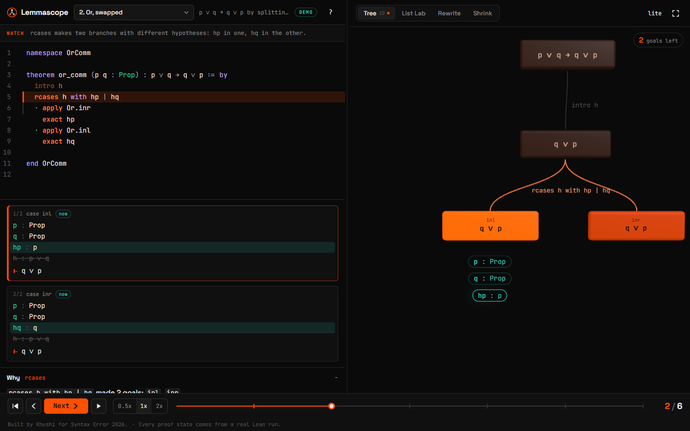

# Lemmascope

**Watch a Lean proof think.** Step through a Lean 4 proof one line at a time while a 3D scene
shows goals splitting, hypotheses arriving, and goals turning gold as they're proved.



<!-- TODO(me): optionally swap in a 15-second GIF (see HUMAN_TASKS.md). -->

> TODO(me): two or three sentences, in your own words, on why you built this. What made Lean
> proofs hard to follow for you, and what you wanted to see instead.

**Try it:** TODO(me): deployed link goes here.

Built by Khushi (team Bilibuu, IITR) for Syntax Error 2026, Functional Programming track.

---

## What it does

Pick a sample, press **Next** (or `→`), and one line of the proof runs. On the right, the picture
keeps up:

- **Tree** (3D, or 2D in lite mode): the graph grows. Goals are nodes, tactics are edges. `constructor`,
  `rcases` and `induction` visibly branch. The active goal's hypotheses float beside it; new ones fly in,
  the ones the line uses get a beam. Proved goals contract, turn gold and drop a star onto the base.
- **List Lab**: a list rearranges. List items in the goal are boxes keyed by value, so when
  `rw [rev]` moves `1` from the front to the back, that box slides there.
- **Rewrite**: before and after, diffed token by token, with what was replaced by what.
- **Shrink**: a goal shrinks down to what was just proved. Theorem on the left, open goals in the
  middle getting smaller, proved goals collapsing onto a shelf.

The player picks the best view per step; picking one yourself overrides that until the next sample.
On the left: the code with the current line lit, the goals infoview-style with a diff, and a **Why**
panel that explains each tactic in plain English (offline, no AI).

## How it works

1. A Lean 4 program ([`lean/Extractor.lean`](lean/Extractor.lean)) elaborates each sample and walks
   Lean's InfoTree, printing every tactic's goals before and after.
2. A pure function ([`buildSteps`](apps/web/src/core/buildSteps.ts)) turns tactics into one step per
   source line ([the rule](docs/STEPPING.md)), and the result is committed as `trace.json`.
3. The site is a static replay engine. `buildFrames(trace)` computes every frame up front.
4. Every view is a function of the current frame. Scrubbing back is an array index, not an undo.
5. Nothing on screen is hand-written: every hypothesis and goal string was printed by Lean.

More in [docs/ARCHITECTURE.md](docs/ARCHITECTURE.md).

## Run it locally

Needs Node 20+ and pnpm 9 (`npm i -g pnpm@9`).

```sh
pnpm install
pnpm dev            # http://localhost:5173
```

Regenerating traces needs Lean ([elan](https://github.com/leanprover/elan)); the toolchain is
pinned in `lean/lean-toolchain`:

```sh
pnpm verify         # lake build: all samples compile
pnpm traces         # run the extractor, rewrite apps/web/public/traces/*.json
pnpm golden         # check the committed traces match a fresh run
pnpm test           # unit tests for the pure core
pnpm build          # static site in apps/web/dist
```

Shortcuts: `→`/`Space` next, `←` back, `Home`/`End`, `P` autoplay, `[` `]` speed, `1`–`4` views,
`F` presentation mode, `L` lite mode, `?` the full list. Click any proof line to jump to it.

## How this relates to Paperproof and lean-tui

I'm not the first to draw Lean proofs. [Paperproof](https://github.com/Paper-Proof/paperproof)
renders Lean 4 proofs as 2D paper-style proof trees inside the editor, and
[lean-tui](https://github.com/lean-tui) is a terminal infoview with tactic and data-flow graphs.
Both are tools you use while writing proofs. Lemmascope is for *watching* one: it's a player
(next, back, scrub, autoplay), it runs from a URL with nothing installed, it has three
coordinated views for the three things the brief asked to see, and it explains each step in
words.

## Limitations

- **Demo mode replays pre-generated traces.** You can't paste your own Lean into the public site;
  Lean doesn't run in a browser.
- **"Used" hypotheses are a heuristic:** a hypothesis counts as used if the line mentions it by name.
  `simp` using one implicitly won't show.
- **`cases ... with | ...` alternatives hide their sibling goals** while you're inside one (see
  [STEPPING.md](docs/STEPPING.md)). The samples avoid that form.
- **`simp` is a black box:** you see before and after, not which lemmas fired.
- List Lab finds lists by reading the pretty-printed goal, so it works on literals and `::` chains,
  not on lists hidden behind definitions.
- Only five samples, all core Lean, no Mathlib.

## Credits

Lean 4 and Lake by the Lean FRO and contributors. three.js, React Three Fiber and drei by pmndrs.
CodeMirror 6 by Marijn Haverbeke. d3-hierarchy by Mike Bostock. Fonts: JetBrains Mono and Space
Grotesk via Fontsource. The extractor's approach follows the InfoTree-walking used by Lean's own
server code and the community `lean-training-data` tools.

MIT licensed.
