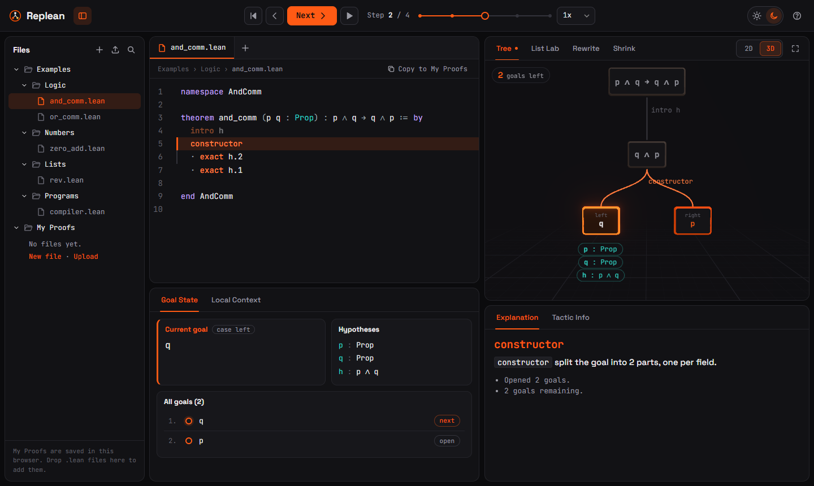

# Replean

A step-through player for Lean 4 proofs. Press **Next** and one line of the proof runs; the goal
tree, the hypotheses and the visualizations update with it.

**Try it:** https://khushijain010.github.io/FPLaunchpad_REPLEAN/



> I first saw Lean at my friend's laptop and couldn’t follow what the proof was doing between lines. Everything important happens in a goal state you can’t see unless you click on each line. I wanted to step through it like a debugger, but with a picture.

Khushi · team Bilibuu · IITR, for Syntax Error 2026 (Functional Programming track).

---

## What you get

| | |
| --- | --- |
| **Files** | Examples grouped by topic (Logic, Numbers, Lists, Programs) and **My Proofs**, your own `.lean` files: new, upload, drag and drop, rename, delete. Saved in your browser. |
| **Editor** | Tabs, the current line highlighted, lines already run dimmed, Lean errors marked in the gutter. Click any proof line to jump to it. |
| **Goal State** | The goal Lean works on next, its hypotheses (new ones highlighted), and every open goal. **Local Context** shows the full diff per goal. |
| **Visualization** | Four views, picked automatically per step: **Tree** (3D or 2D), **List Lab**, **Rewrite**, **Shrink**. Full-screen mode for presenting. |
| **Explanation** | What the tactic that just ran did, in plain English: which hypotheses it used, which goals it opened or closed. Works offline. |
| **Playback** | Next, back, reset, autoplay at three speeds, and a scrubber, all in the header. |
| **Themes** | Light and dark, across the whole app, the editor and the 3D scene. |

### The four views

- **Tree**: the graph grows. Goals are nodes, tactics are edges; `constructor`, `rcases` and
  `induction` visibly branch. Proved goals turn gold and drop into a row along the bottom.
- **List Lab**: a list rearranges. List elements in the goal are boxes keyed by value, so when
  `rw [rev]` moves `1` from the front to the back, that box slides there.
- **Rewrite**: before and after, diffed token by token, with what was replaced by what.
- **Shrink**: a goal shrinks down to what was just proved. Theorem on the left, open goals in the
  middle getting smaller, proved goals collapsing onto a shelf.

![Replean in light mode: List Lab on rev [1, 2, 3]](docs/screenshots/hero-light.png)

### Your own proofs

Make a file under **My Proofs** (or **Copy to My Proofs** from an example), press **Run**
(`Ctrl+Enter`), and it plays like the examples. A Lean server runs it: locally `pnpm live`, and on
the deployed site a hosted, sandboxed one ([docs/LIVE.md](docs/LIVE.md)). If Lean rejects a line,
its error message appears in the visualization panel and the failing goal turns red.

Replean runs **core Lean 4** (no Mathlib). A file that imports Mathlib gets a plain explanation and
core replacements for the tactics it uses, such as `omega` for `ring`.

## How it works

1. A Lean 4 program ([`lean/Extractor.lean`](lean/Extractor.lean)) elaborates a file and walks
   Lean's InfoTree, printing every tactic's goals before and after.
2. A pure function ([`buildSteps`](apps/web/src/core/buildSteps.ts)) turns tactics into one step per
   source line ([the rule](docs/STEPPING.md)). The examples' results are committed as JSON traces.
3. `buildFrames(trace)` computes every frame up front, so scrubbing back is an array index, not an
   undo.
4. Every panel is a function of the current frame.
5. Nothing on screen is hand-written: every hypothesis and goal string was printed by Lean.

More in [docs/ARCHITECTURE.md](docs/ARCHITECTURE.md).

## Run it locally

Needs Node 20+ and pnpm 9 (`npm i -g pnpm@9`).

```sh
pnpm install
pnpm dev            # http://localhost:5173 (examples only)
pnpm live           # the same, plus a local Lean server on 127.0.0.1:8791 for your own files
```

Running your own files and regenerating the example traces need Lean
([elan](https://github.com/leanprover/elan)); the toolchain is pinned in `lean/lean-toolchain`.

```sh
pnpm verify         # lake build: all examples compile
pnpm traces         # rerun the extractor and rewrite apps/web/public/traces/*.json
pnpm golden         # check the committed traces match a fresh Lean run
pnpm test           # unit tests (core + server)
pnpm ui-check       # click every control in a real browser (needs pnpm preview + pnpm server)
pnpm build          # static site in apps/web/dist
```

### Shortcuts

| Key | Action | Key | Action |
| --- | --- | --- | --- |
| `→` / `Space` | Next line | `1`–`4` | Tree, List Lab, Rewrite, Shrink |
| `←` | Previous line | `D` | 2D / 3D tree |
| `Home` / `End` | Start / end | `F` | Full screen |
| `P` | Autoplay | `B` | Files panel |
| `[` `]` | Slower / faster | `T` | Light / dark theme |
| `?` | Help | `Esc` | Close dialogs, leave full screen |

## Related work

[Paperproof](https://github.com/Paper-Proof/paperproof) renders Lean 4 proofs as 2D paper-style
proof trees inside the editor, and [lean-tui](https://github.com/lean-tui) is a terminal infoview
with tactic and data-flow graphs. Both are tools for writing proofs. Replean is for watching and
presenting one: a player with scrubbing and autoplay, four coordinated views, explanations in
words, and nothing to install.

## Limitations

- **Core Lean only.** Mathlib is several gigabytes and needs far more memory than the free server.
- **The hosted server sleeps when idle** (free plan), so the first run after a quiet spell can take
  up to a minute. It refuses code-running commands (`#eval`, `native_decide`, macros, `import`);
  see [docs/LIVE.md](docs/LIVE.md) for the security trade-offs.
- **"Used" hypotheses are a heuristic:** a hypothesis counts as used if the line mentions it by name.
- **`simp` is a black box:** you see before and after, not which lemmas fired.
- **`cases … with | …` alternatives hide their sibling goals** while you're inside one
  ([STEPPING.md](docs/STEPPING.md)); `rcases` with bullets keeps every goal visible.
- **List Lab reads the printed goal**, so it handles list literals and `::` chains, not lists hidden
  behind definitions.

## Credits

Lean 4 and Lake by the Lean FRO and contributors. three.js, React Three Fiber and drei by pmndrs.
CodeMirror 6 by Marijn Haverbeke. d3-hierarchy by Mike Bostock. Fonts: JetBrains Mono and Space
Grotesk via Fontsource. The extractor follows the InfoTree walking used by Lean's own server code
and the community `lean-training-data` tools.
